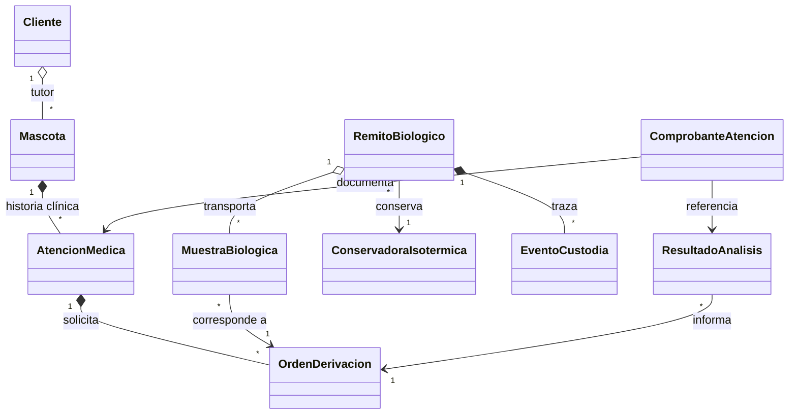

# Requisitos, casos de uso y modelo de dominio

## Alcance y actores

La solución cubre la atención clínica en una red de clínicas, el traslado controlado de
muestras al laboratorio central y la devolución de resultados. Actores: personal
administrativo de clínica, veterinario, responsable de transporte, personal de laboratorio
y cliente/tutor. Este entregable implementa las reglas del dominio; la persistencia,
autenticación, permisos, interfaz y comunicación externa quedan fuera de alcance.

## Requisitos funcionales

| ID | Requisito |
|---|---|
| RF-01 | Administrar clientes con datos de contacto y asociarles mascotas. |
| RF-02 | Administrar mascotas y conservar su historia de atenciones médicas. |
| RF-03 | Registrar consultas con veterinario, motivo, fecha y diagnóstico; emitir una o más órdenes de derivación vinculadas a la atención. |
| RF-04 | Identificar muestras y asociarlas a órdenes; incluirlas en un remito biológico con clínica de origen, laboratorio de destino, conservadora isotérmica y precinto sanitario. |
| RF-05 | Registrar eventos cronológicos de custodia, con responsable, ubicación, fecha/hora y temperatura. |
| RF-06 | Registrar la recepción en el laboratorio, el estado del precinto y la temperatura; determinar viabilidad según precinto íntegro, temperaturas dentro del rango configurado y vigencia de todas las muestras. |
| RF-07 | Registrar resultados sólo para órdenes incluidas en un remito recibido viable y emitir el comprobante de atención cuando todas las órdenes de la atención tengan resultado. |

## Reglas de negocio

1. Una mascota sólo puede registrarse con su tutor correspondiente; las atenciones se
   agregan a la historia de esa mascota y sus órdenes deben pertenecer a la atención.
2. Un remito debe contener al menos una muestra y una orden; cada muestra refiere a una
   de las órdenes incluidas. No se admiten identificadores de muestra repetidos.
3. El armado del remito precinta el envío y cambia sus órdenes de `EMITIDA` a
   `EMPAQUETADA`. Una orden no puede empaquetarse dos veces ni tener más de un resultado.
4. La primera ubicación registrada en la custodia es la clínica de origen. Los eventos no
   pueden preceder al armado ni retroceder en el tiempo; cada temperatura debe estar dentro
   del rango de la conservadora. La recepción exige que el último evento esté en el
   laboratorio de destino.
5. Una muestra es viable al recibirla sólo si el precinto está íntegro, la temperatura de
   recepción y todas las temperaturas registradas están dentro del rango, y ninguna muestra
   superó su fecha de vigencia.
6. Un remito recibido no admite cambios de custodia. Un remito no viable no admite resultados.
7. El comprobante de atención requiere resultados para todas las órdenes de derivación de
   esa atención.

Los rangos térmicos y la vigencia se reciben como datos del dominio. Sus valores clínicos
deben definirse según el tipo de muestra y los protocolos del laboratorio; el modelo no
prescribe umbrales médicos.

## Casos de uso

### CU-01 — Administrar cliente y mascota

- **Actor principal:** personal administrativo.
- **Precondición:** el cliente está identificado.
- **Flujo:** registrar datos de contacto; crear mascota con identificador, nombre, especie y
  tutor; asociarla al cliente.
- **Alternativas:** rechazar datos obligatorios vacíos, mascota con otro tutor o identificador
  duplicado para ese cliente.
- **Resultado:** la mascota queda vinculada al cliente y lista para registrar atenciones.

### CU-02 — Registrar atención y derivar análisis

- **Actor principal:** veterinario.
- **Precondición:** la mascota existe.
- **Flujo:** registrar atención con veterinario y motivo; agregarla a la historia clínica;
  emitir una orden asociada a la atención con tipo de muestra y análisis solicitado.
- **Alternativas:** rechazar una orden vinculada a otra atención.
- **Resultado:** atención y orden quedan asociadas a la historia clínica de la mascota.

### CU-03 — Empaquetar y remitir muestras

- **Actor principal:** personal de clínica.
- **Precondición:** existen órdenes emitidas y muestras recolectadas con vigencia definida.
- **Flujo:** indicar clínica y laboratorio, conservadora con rango térmico, muestras y
  precinto; crear el remito; registrar la salida desde la clínica y cada transferencia hasta
  la llegada al laboratorio.
- **Alternativas:** rechazar órdenes ya empaquetadas, muestras sin orden incluida, eventos
  fuera de secuencia o temperaturas fuera de rango.
- **Resultado:** remito y cadena de custodia quedan asociados; las órdenes pasan a
  empaquetadas.

### CU-04 — Recibir muestras en laboratorio

- **Actor principal:** personal de laboratorio.
- **Precondición:** el envío está en tránsito y tiene un evento de llegada al laboratorio.
- **Flujo:** registrar integridad del precinto, temperatura y hora de recepción; evaluar la
  vigencia de las muestras y la cadena térmica.
- **Alternativas:** precinto roto, temperatura fuera de rango o muestra vencida resultan en
  recepción no viable; el sistema bloquea la carga de resultados.
- **Resultado:** queda registrada la recepción viable o no viable.

### CU-05 — Registrar resultados y emitir comprobante

- **Actor principal:** personal de laboratorio y veterinario.
- **Precondición:** la muestra fue recibida viable.
- **Flujo:** registrar valores e interpretación por orden; al completarse todas las órdenes
  de la atención, emitir comprobante que referencia los resultados.
- **Alternativas:** rechazar resultados de otro laboratorio, órdenes no recibidas o
  comprobantes incompletos.
- **Resultado:** resultados quedan vinculados a sus órdenes y el comprobante a la atención.

## Modelo de dominio

### Estados principales

- **Orden:** `EMITIDA` → `EMPAQUETADA` → `RESULTADO_DISPONIBLE`.
- **Remito:** `PREPARADO` → `EN_TRANSITO` → `RECIBIDO_VIABLE` o
  `RECIBIDO_NO_VIABLE`.
